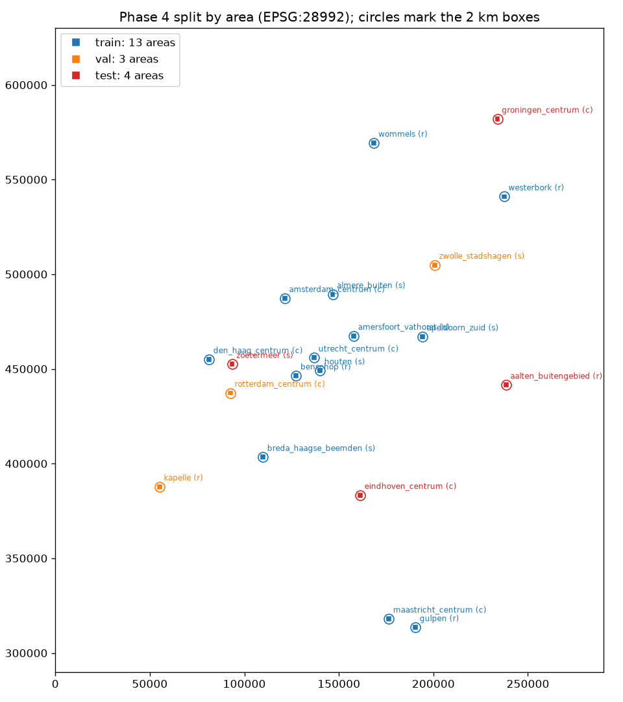

# Phase 4: Surface-class segmentation

A U-Net with a ResNet-18 encoder (ImageNet weights) is trained on CPU. It labels
every 25 cm pixel with one of 7 classes taken from BGT:

background, carriageway, inrit, parking, cycle, footpath, other_paved.

The class mapping is in `config.SURFACE_CLASSES`. The labels follow the Phase 3
rules: paved terrain under service ways and busways counts as carriageway,
`spoorbaan` counts as background, and levels below 0 are dropped.

- Code: `backbone.surface_data` (labels, image resampling, chips),
  `backbone.train_surface` and `backbone.eval_surface`.
- Generated tables: [metrics.md](metrics.md).

## Split (spatial, by area)

| Split | Areas |
|---|---|
| Train (13) | The 3 pilot areas plus 10 others |
| Validation (3) | rotterdam_centrum (city), zwolle_stadshagen (suburb), kapelle (rural) |
| Test (4) | groningen_centrum, eindhoven_centrum (city), zoetermeer (suburb), aalten_buitengebied (rural) |

The validation and test areas were drawn with a fixed seed, before any training.
The test areas were used once, for the numbers below. Nothing was tuned on them.

## Training run `experiments/2026-10-14_full_r18`

- **Data:** 256 px chips (64 m) sampled from 39,182 training candidates.
- **Schedule:** 10 epochs × 500 steps, batch 16, AdamW with OneCycle (peak lr
  1e-3). Took 133 minutes on 12 CPU threads.
- **Loss:** cross-entropy with inverse-sqrt-frequency class weights, plus Dice.
- **Augmentation:** rot90 and flips; random blur by downsampling 1–4×; colour
  jitter.
- **Pipeline check:** before this run, the pipeline overfitted 64 chips to an
  IoU of at least 0.97 on every class.

Validation IoU per epoch (600 tiles):

| Epoch | Background | Carriageway | Inrit | Parking | Cycle | Footpath | Other paved |
|---|---|---|---|---|---|---|---|
| 0 | 0.78 | 0.36 | 0.00 | 0.22 | 0.11 | 0.23 | 0.00 |
| 2 | 0.84 | 0.44 | 0.02 | 0.29 | 0.15 | 0.25 | 0.01 |
| 4 | 0.82 | 0.47 | 0.03 | 0.31 | 0.22 | 0.33 | 0.02 |
| 6 | 0.86 | 0.53 | 0.04 | 0.38 | 0.27 | 0.39 | 0.02 |
| 8 | 0.88 | 0.57 | 0.05 | 0.40 | 0.27 | 0.38 | 0.03 |
| 9 | 0.89 | 0.58 | 0.05 | 0.40 | 0.28 | 0.40 | 0.03 |

The curve was still rising slowly when the learning-rate schedule ended. The
model is undertrained: it saw 80,000 chips, about 2 passes over the candidates.

## Held-out results (whole areas, 8 cm imagery averaged to 25 cm)

These are pixel IoUs. "Width mIoU" is the mean over carriageway, inrit, parking
and cycle.

| | Carriageway | Inrit | Parking | Cycle | Footpath | Width mIoU |
|---|---|---|---|---|---|---|
| Validation | 0.59 | 0.05 | 0.42 | 0.30 | 0.41 | 0.34 |
| Test | 0.58 | 0.04 | 0.34 | 0.36 | 0.36 | 0.33 |
| Test, city | 0.55 | 0.02 | 0.29 | 0.32 | 0.36 | 0.30 |
| Test, suburb | 0.67 | 0.03 | 0.42 | 0.44 | 0.37 | 0.39 |
| Test, rural | 0.51 | 0.10 | 0.07 | 0.25 | 0.01 | 0.23 |

On test carriageway, recall and precision are both about 0.74. Where the model
misses carriageway, it mostly predicts footpath (11%), parking (6%), background
(5%) or cycle (3%). Inrit essentially fails: only 13% of its pixels are
recognised, and the rest are spread over footpath, carriageway, background and
cycle.

### Resolution and source robustness (test split)

| Source | Carriageway | Width mIoU |
|---|---|---|
| 8 cm → 25 cm (training domain) | 0.58 | 0.33 |
| 8 cm → 50 cm, resized back | 0.57 | 0.33 |
| 8 cm → 1 m, resized back | 0.55 | 0.31 |
| PDOK 25 cm product (another flight) | 0.42 | 0.22 |

Coarser resolution costs little. The 25 cm product costs a lot. That product is
a different flight with different colour and lean, and the model never saw it
in training. For Phase 5, use the probabilities from the 8 cm source. Both
sources are saved as `data/<area>/ml/prob_full_r18_{8cm,25cm}.npy`.

## What the galleries show

These are test chips ranked by width mIoU, out of 2,574 chips that are at least
3% carriageway.

- **Median** ([gallery_median.jpg](gallery_median.jpg)): the road shape is
  right and edges follow the kerbs. Carriageway IoU in these chips is 0.65–0.95.
  The errors are at class borders inside the paved area: cycle lanes coloured
  like the road, parking strips merging with the footway, and shadows from
  buildings.
- **Best** ([gallery_best.jpg](gallery_best.jpg)): rural roads with parallel
  cycle paths, with IoU above 0.92.
- **Worst** ([gallery_worst.jpg](gallery_worst.jpg)): mostly cases where the
  label disagrees with what is visible, not model errors.
  - Rural sand and grass tracks in Aalten that BGT records as `rijbaan lokale
    weg` with surface `onverhard`. The model calls them other_paved or
    background. Unpaved roads make up 22% of Aalten's drivable BGT area, but
    only 0–4% in the other test and validation areas. This is the main reason
    the rural test IoU is low.
  - Roads hidden under tree canopy.
  - A tiled terrain polygon in Zoetermeer that sits under a service way at
    level 0 while the photo shows water and a building. This is the same
    roads-under-structures issue noted at Hoog Catharijne.

## Assessment

The model finds where roads are and where their edges run. Telling apart the
adjacent paved classes (carriageway, cycle, parking, footpath) is still weak.
This matters for Phase 5, because the carriageway-width definition depends on
exactly those borders.

The 0.58 carriageway IoU does not decide whether this is good enough. The
Phase 5 width error against the B2 baseline does: a carriageway MAE of 1.22 m.

Unpaved rijbaan is a labelling question rather than a model question. Options
are to keep it as carriageway, to map it to its own class, or to leave it out
of scoring.
